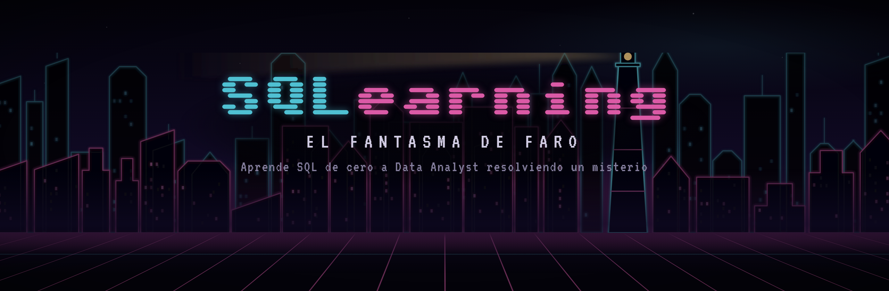
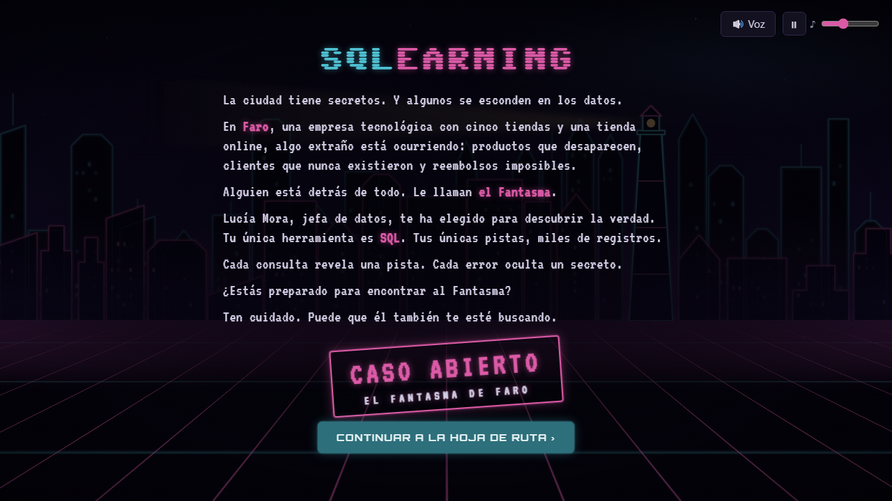
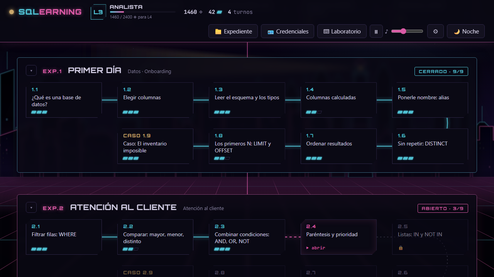
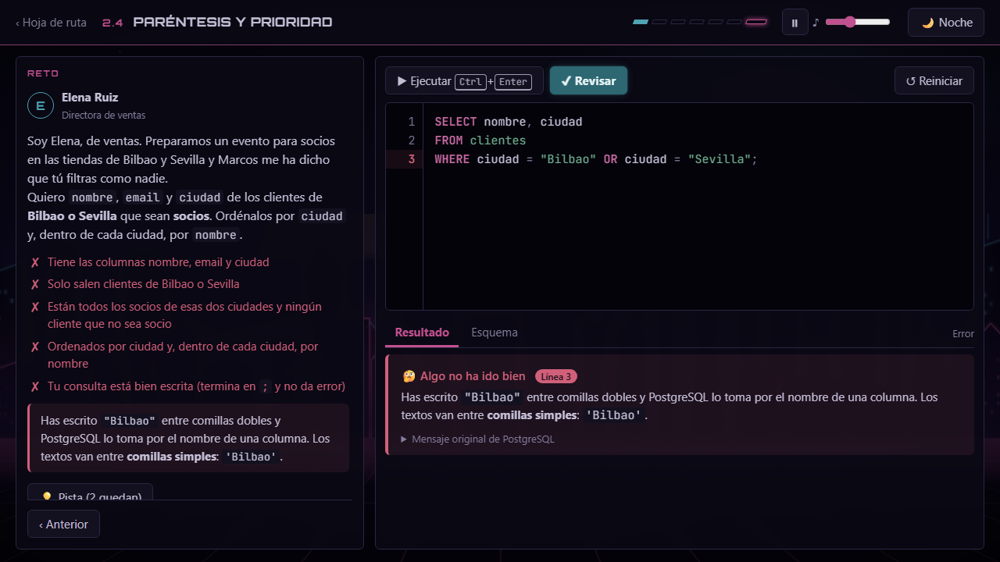
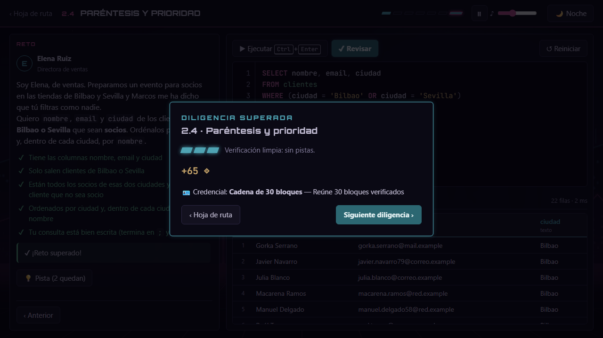
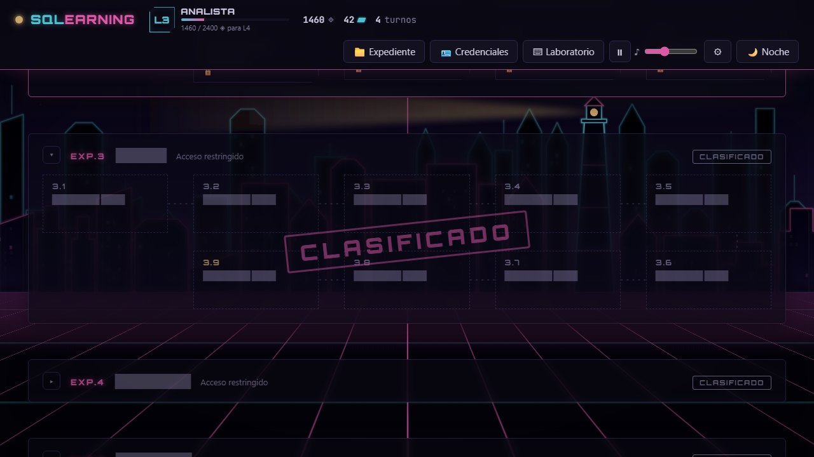
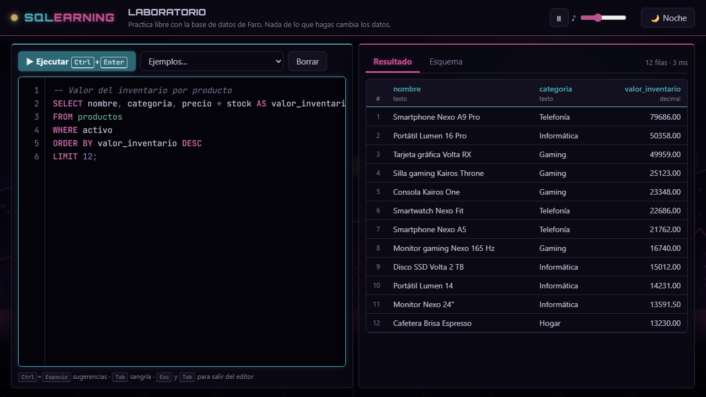

<p align="center">
  <a href="https://piradev-py.github.io/SQLearning/"></a>
</p>

```text
> CONECTANDO CON FARO.DB ...
> ACCESO CONCEDIDO · NIVEL L1 · BECARIO
> EXPEDIENTE: EL FANTASMA DE FARO [CASO ABIERTO]
```

<p align="center">
  
  
  
  
</p>

> La ciudad tiene secretos. Y algunos se esconden en los datos.
>
> En **Faro**, una empresa tecnológica con cinco tiendas y una tienda online, algo extraño está ocurriendo:
> productos que desaparecen, clientes que nunca existieron y reembolsos imposibles.
>
> Alguien está detrás de todo. Le llaman **el Fantasma**.
>
> Lucía Mora, jefa de datos, te ha elegido para descubrir la verdad. Tu única herramienta es **SQL**.
> Tus únicas pistas, miles de registros.
>
> Ten cuidado. Puede que él también te esté buscando.

<p align="center">
  <a href="https://piradev-py.github.io/SQLearning/"></a>
</p>

---

## 🗂️ Qué es

Un curso-juego para aprender **SQL de cero a Data Analyst** resolviendo un misterio. Escribes consultas reales en
**PostgreSQL de verdad**, que corre dentro de tu navegador: no hay que instalar nada, y puedes equivocarte (o borrar
tablas) sin miedo, porque nada de lo que hagas estropea los datos.

<p align="center">
  
  
</p>
<p align="center">
  
  
</p>

- **Hoja de ruta del caso:** cada expediente es una línea de investigación; cada diligencia, una herramienta de SQL.
  Los expedientes que aún no has abierto siguen **clasificados**.
- **Revisión por resultado:** da igual cómo escribas la consulta; importa lo que devuelve. Los errores de PostgreSQL
  se explican en español de novato («los textos van entre comillas simples…»).
- **Recompensas de analista:** créditos ◈, bloques verificados (más si no usas pistas), credenciales y niveles de
  autorización, de **L1 Becario** a **L6 Head of Data**.
- **Laboratorio:** zona de práctica libre con toda la base de datos de Faro.

<p align="center">
  
  
</p>

## 📁 Expedientes

| Expediente | Línea de investigación | Estado |
|---|---|---|
| **EXP.0** · El archivo de papel *(opcional)* | Pensar en datos antes de tocar una tecla: tipos, lógica, conjuntos, entidades, relaciones, diagramas ER, privacidad | 🟢 abierto |
| **EXP.1** · Primer día | `SELECT`, columnas calculadas, alias, `DISTINCT`, `ORDER BY`, `LIMIT`… y un inventario imposible | 🟢 abierto |
| **EXP.2** · Atención al cliente | `WHERE`, `AND`/`OR`/`NOT`, `IN`, `BETWEEN`, `LIKE`/`ILIKE`, `NULL`… y clientes de madrugada | 🟢 abierto |
| **EXP.3** · Ventas | `COUNT`, `SUM`, `AVG`, `MIN`/`MAX`, `GROUP BY`, `HAVING`, el orden en que piensa SQL, tus primeros gráficos… y unos reembolsos disparados | 🟢 abierto |
| **EXP.4** · `█████████` | `███ ██████ █████` | 🔒 CLASIFICADO |
| **EXP.5** · `█████████` | `██████ █ ██████` | 🔒 CLASIFICADO |
| **EXP.6** · `██` | `████ ██ ████████` | 🔒 CLASIFICADO |
| **EXP.7** · `█████████` | `█████████ ████████` | 🔒 CLASIFICADO |
| **EXP.8** · `█████████` | `██████ ██████` | 🔒 CLASIFICADO |

Funciona en cualquier navegador moderno de ordenador o tablet. La primera visita descarga unos 6 MB (el motor de
PostgreSQL); después queda en la caché.

---

<details>
<summary><b>⌨️ Para programadores</b></summary>

HTML, CSS y JavaScript sin frameworks ni compilación. PostgreSQL corre en el navegador con
[PGlite](https://github.com/electric-sql/pglite) (vendorizado en `vendor/pglite/`) dentro de un Web Worker.

```
npm run servir     # servidor local en http://localhost:8080 (PGlite necesita http, no file://)
npm test           # todas las baterías en Edge sin ventana (tests/navegador/)
npm run datos      # regenera los datos de Faro (semillas fijas) y la ciudad neón
node tests/navegador/cdp.mjs esc-readme.mjs   # rehace las imágenes de este README
```

| Dónde | Qué |
|---|---|
| `js/motor-sql.js`, `js/motor-worker.js` | Motor: transacción de práctica, corte por tiempo, recarga si el alumno se sale |
| `js/revisor-sql.js`, `js/pruebas.js` | Revisión por resultado (no por cómo se escribe la consulta) |
| `js/leccion.js`, `js/papel.js` | Página de lección y pasos «sobre el papel» |
| `lecciones/` | Contenido (formato en `docs/FORMATO_LECCION.md`) |
| `datos/`, `herramientas/generar-datos.mjs` | Datos de Faro por etapa (ver `docs/DATOS.md`) |
| `docs/` | Plan del curso, historia, estilo, pendientes, licencias y revisiones |

⚠️ `docs/HISTORIA.md` y `docs/DATOS.md` contienen la solución del misterio.

</details>

**Créditos:** PGlite (Apache-2.0) · música y voz hechas con Suno · fuentes Orbitron, JetBrains Mono, VT323 y
Sixtyfour (Google Fonts, OFL). Detalle en `docs/LICENCIAS.md`.
